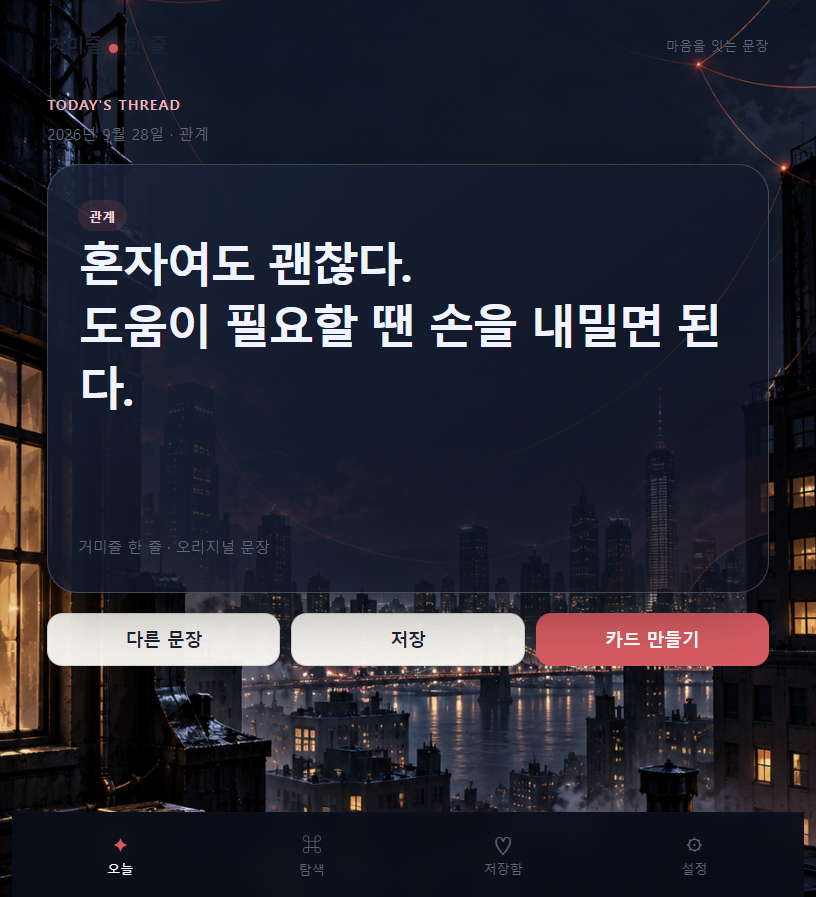
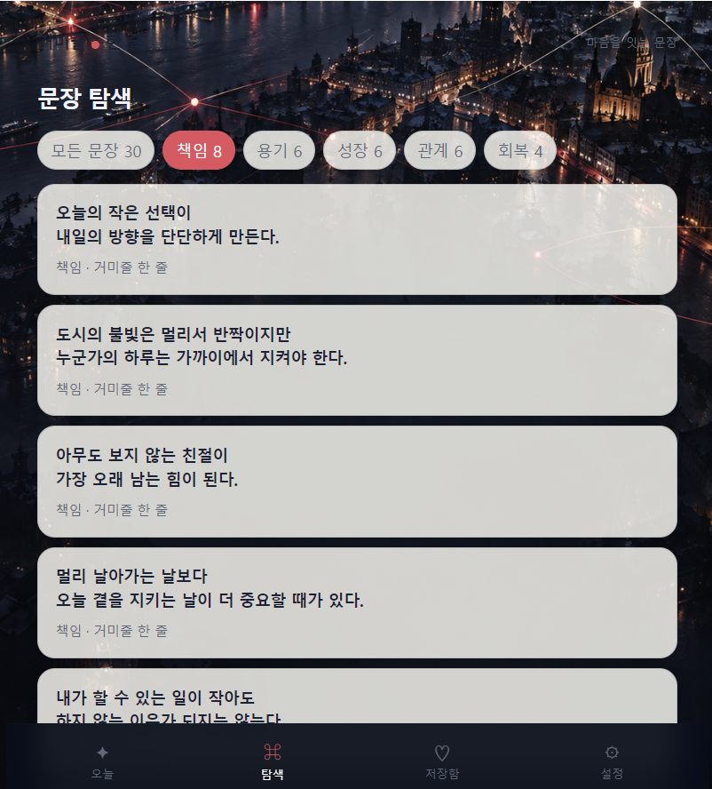
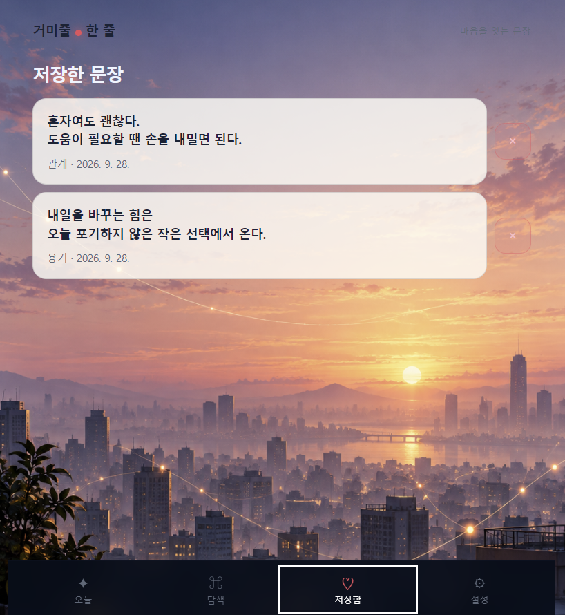
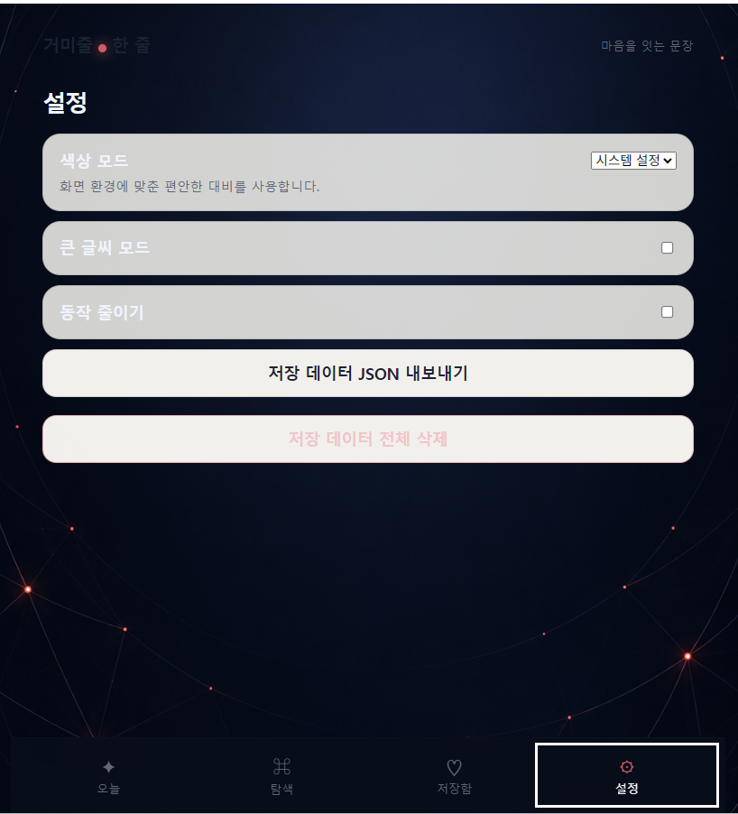

# 거미줄 한 줄

<p align="center">
  
  
  
  
</p>

책임, 용기, 성장, 관계, 회복에 관한 오리지널 문장을 읽고 저장하는 모바일 우선 웹 앱입니다. 스파이더 히어로의 도시적 분위기를 추상 연결선과 색감으로 표현하되, 캐릭터·로고·실제 대사는 사용하지 않습니다.

## 이번 작업 내용

- `quotes.json`의 오리지널 문장 30개를 앱 시작 시 불러오도록 연결했습니다.
- 날짜를 기준으로 같은 날에는 같은 오늘의 문장을 보여 주고, `다른 문장`으로 같은 카테고리의 문장을 탐색할 수 있게 했습니다.
- 전체·책임·용기·성장·관계·회복 카테고리별 문장 목록과 개수를 제공했습니다.
- 즐겨찾기 저장, 최신순 저장함, 저장 취소를 브라우저 `localStorage`로 구현했습니다.
- Canvas API로 1080 × 1350 PNG 문장 카드를 생성하고, 지원 기기에서는 공유할 수 있게 했습니다.
- 다크/라이트 모드, 큰 글씨, 동작 줄이기, 저장 데이터 JSON 내보내기와 전체 삭제 설정을 추가했습니다.
- 오늘·탐색·저장함·설정 화면에 각각 다른 오리지널 도시/연결선 배경 이미지를 적용했습니다.
- 웹 앱 매니페스트와 서비스 워커를 추가해 PWA 확장이 가능하도록 구성했습니다.

## 오류 수정 및 안정성 개선

- 정적 파일 캐시 때문에 새 CSS·JavaScript·배경이 즉시 반영되지 않는 문제를 수정했습니다. 서비스 워커는 이제 설치 후 즉시 활성화되며, 네트워크 우선 방식으로 최신 파일을 가져오고 오프라인일 때 캐시를 사용합니다.
- 스타일과 스크립트 파일에 버전 쿼리를 적용해 이전 브라우저 캐시로 인한 화면 불일치를 줄였습니다.
- JSON 로드·`localStorage` 파싱 실패 시 앱 전체가 중단되지 않고 재시도 또는 기본값을 제공하도록 처리했습니다.
- 저장 중복을 막고, 저장 취소 전 확인 창을 표시하도록 보완했습니다.
- 키보드 포커스 표시, 44px 이상의 버튼 크기, 동작 줄이기 설정을 적용했습니다.

## 실행 방법

브라우저의 `file://` 직접 실행은 JSON 로드를 차단할 수 있습니다. 프로젝트 폴더에서 정적 서버를 실행한 뒤 접속하세요.

```powershell
python -m http.server 4173
```

그다음 [http://localhost:4173](http://localhost:4173)에서 확인합니다.

## 프로젝트 구조

```text
.
├── index.html
├── style.css
├── app.js
├── quotes.json
├── assets/                 # 화면별 오리지널 배경 이미지
├── docs/screenshots/       # README 화면 미리보기
├── public/manifest.webmanifest
└── sw.js
```

## 기술

HTML, CSS, Vanilla JavaScript, Canvas API, Web Share API, localStorage, Service Worker
